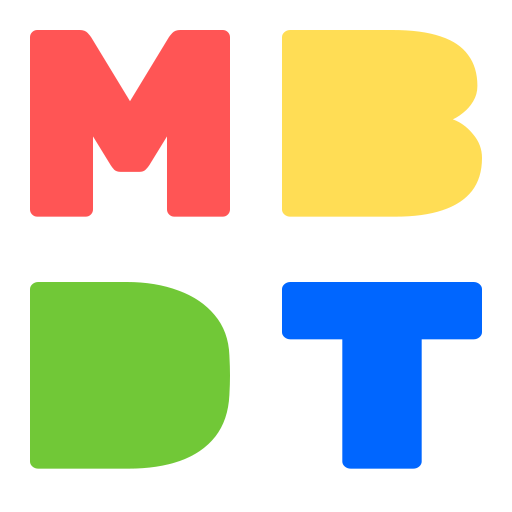
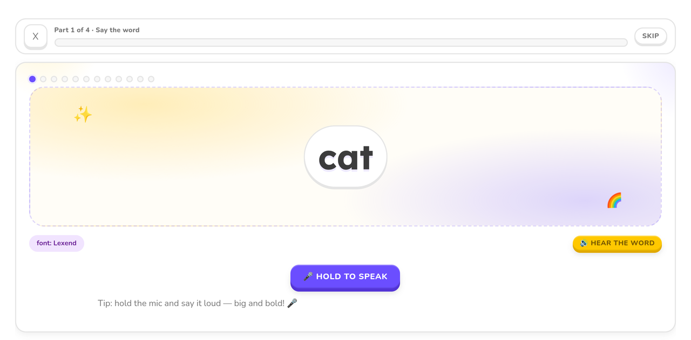
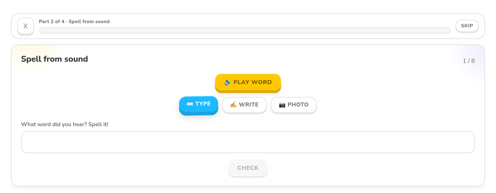
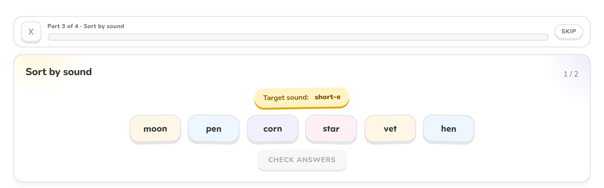
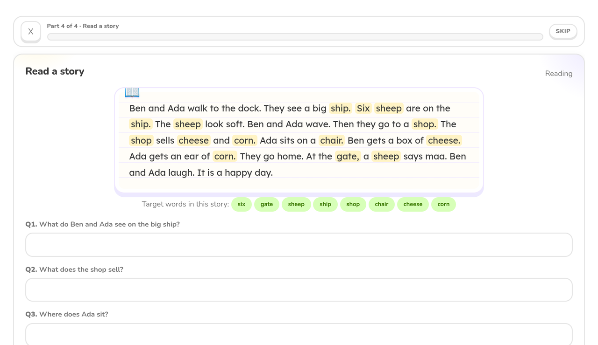

<div align="center">



# MBDT

**Adaptive, locally-deployed literacy practice for children with dyslexia.**

[](LICENSE)
[](pyproject.toml)
[](package.json)
[](backend/app.py)
[](backend/db.py)

</div>

> [!IMPORTANT]
> **MBDT is supplementary practice. It is not therapy, diagnosis, or medical advice.**
> It does not treat, cure, or prevent dyslexia or any other condition. No educational,
> health, or other outcome is claimed or guaranteed. It is not a substitute for
> assessment or support from a qualified teacher, educational psychologist,
> speech-language therapist, or doctor. See [Disclaimer](#disclaimer).

MBDT turns Orton-Gillingham-style literacy exercises into short, playful sessions.
A per-word adaptive model decides what each learner should practice next. The app runs on one
computer. Learner records, review history, and guardian settings live in a single
SQLite file. The backend's only outbound traffic is the specific word, audio clip, image,
or prompt a model needs to answer.

## Contents

- [What MBDT does](#what-mbdt-does)
  - [Screens](#screens)
- [What you need](#what-you-need)
- [Install and run](#install-and-run)
  - [Windows 10 or 11](#windows-10-or-11)
  - [macOS](#macos)
  - [Linux](#linux)
  - [If you already have the tools](#if-you-already-have-the-tools)
- [First run](#first-run)
- [Configure the API key](#configure-the-api-key)
- [Troubleshooting](#troubleshooting)
- [Using the app](#using-the-app)
- [Add your own word set](#add-your-own-word-set)
- [How the adaptive engine works](#how-the-adaptive-engine-works)
- [Privacy and data](#privacy-and-data)
- [Development](#development)
- [Deployment](#deployment)
- [Limitations](#limitations)
- [Disclaimer](#disclaimer)
- [License](#license)

## What MBDT does

A daily session has four activities with short breaks between them.

| # | Activity | What the learner does | Models used |
|---|---|---|---|
| 1 | **Say the word** | Words move across the screen in different fonts. The learner says each word aloud. | Speech-to-text, text-to-speech |
| 2 | **Spell from sound** | The learner hears a word, then types it, writes it on a canvas, or photographs handwriting. | Text-to-speech, OCR |
| 3 | **Sort by sound** | The learner picks every word that shares a target phoneme. | None |
| 4 | **Read a story** | A short story is generated from the learner's weakest words. The learner answers three questions about it. | Language model |

Around the exercises, the app shows a streak, XP, levels, daily quests, a lesson path,
and per-word mastery bars. These come from real review records.

Guardian controls are in the Guardian tab: word set, story interests, topics to avoid,
a confidence floor for pronunciation verdicts, a story model override, and a
hide-celebrations toggle. The Admin tab has demo tools (skip or reset a day, change the
password) and a connection and model panel.

### Screens

| Say the word | Spell from sound |
|:---:|:---:|
| [](site/assets/screens/ex1-speak.png) | [](site/assets/screens/ex2-spell.png) |

| Sort by sound | Read a story |
|:---:|:---:|
| [](site/assets/screens/ex3-sort.png) | [](site/assets/screens/ex4-story.png) |

## What you need

- A computer running Windows 10 or 11, macOS 12 or newer, or a recent Linux distribution.
- A modern browser: Chrome, Edge, Firefox, or Safari.
- A microphone for the speaking activity.
- An internet connection for speech, handwriting, and story models.
- About 1 GB of free disk space for the project and its dependencies.
- A Requesty or OpenRouter API key for the AI features. The app still runs without one, but speech,
  handwriting, and story calls will return an error.

You do not need a GPU, a hosting account, or programming experience. The only account you
need is a Requesty or OpenRouter account for the AI features. The guides below assume you have never
used a terminal before.

## Install and run

Choose the section for your operating system. Follow the numbered steps in order. If you
already have the tools, the short version is at the end of this section.

A few terms used below:

- **Terminal** means the text window where you type commands. On Windows it is called
  PowerShell.
- **Command** means a line of text you paste into the terminal and run by pressing Enter.
- **Project folder** means the folder that contains this `README.md` file.

Copy one command at a time. Lines that start with `#` are comments and do not need to be
typed. If a command finishes without printing an error, it worked.

If you are reading this on GitHub, download the ZIP or clone the repository first, then
open the folder that contains `README.md`, `backend`, and `frontend`.

### Windows 10 or 11

#### Step 1: Open PowerShell

Press the Windows key, type `PowerShell`, and open **Windows PowerShell**. On Windows 11
you can also right-click the Start button and choose **Terminal**.

You will type the rest of the commands in this window.

#### Step 2: Install uv

uv installs and runs Python for this project.

```powershell
powershell -ExecutionPolicy ByPass -c "irm https://astral.sh/uv/install.ps1 | iex"
```

Close PowerShell and open a new PowerShell window so the new command is available.
Then check the installation:

```powershell
uv --version
```

You should see a version number. If you see "not recognized", close and reopen PowerShell
and try again.

#### Step 3: Install Python 3.12

```powershell
uv python install 3.12
```

You do not need to install Python separately. uv handles it.

#### Step 4: Install Node.js 20 or newer

1. Open <https://nodejs.org/en/download> in your browser.
2. Download the **LTS** installer for Windows.
3. Run the installer and accept the default options.
4. Close PowerShell and open a new PowerShell window.
5. Check the version:

```powershell
node --version
```

The number must start with `v20` or higher, for example `v22.14.0`. If the command is not
recognized, close and reopen PowerShell. If the version is lower than 20, install the LTS
version again.

#### Step 5: Install pnpm

```powershell
npm install -g pnpm
```

If you see a permission error, open PowerShell as Administrator and run the command
again. Close and reopen PowerShell, then check:

```powershell
pnpm --version
```

#### Step 6: Open the project folder

If you downloaded a ZIP file, extract it first. If someone shared a folder with you, use
that folder. The folder should contain `README.md`, `backend`, and `frontend`.

In PowerShell, move into the project folder:

```powershell
cd "C:\Users\Your Name\Downloads\mbdt"
```

Replace the path with the real path on your computer. A quicker way: type `cd ` (with a
space after it), drag the project folder into the PowerShell window, and press Enter.

#### Step 7: Create the settings file

```powershell
Copy-Item backend\.env.example backend\.env
```

Open the new file in Notepad:

```powershell
notepad backend\.env
```

Find this line:

```text
MBDT_REQUESTY_API_KEY=sk-...
```

Replace `sk-...` with your Requesty API key. To use OpenRouter instead, set
`MBDT_PROVIDER=openrouter` and put the `sk-or-v1-...` key on the
`MBDT_OPENROUTER_API_KEY` line. Do not add spaces around the `=` sign.
Save the file and close Notepad. The next section explains how to get a key if you do not
have one yet.

#### Step 8: Install the project dependencies

```powershell
uv sync
pnpm install
```

These commands download the Python and JavaScript packages the app needs. They may take
a few minutes. Wait until both commands finish.

#### Step 9: Start the backend

Leave this PowerShell window open. Run:

```powershell
uv run uvicorn app:app --app-dir backend --port 8777 --reload
```

You should see a line like:

```text
Uvicorn running on http://127.0.0.1:8777
```

Keep this window open. It is the backend server.

#### Step 10: Start the frontend

Open a **second** PowerShell window. Go to the same project folder:

```powershell
cd "C:\Users\Your Name\Downloads\mbdt"
```

Then run:

```powershell
pnpm dev
```

You should see a line like:

```text
Local: http://localhost:5173
```

Keep this window open too.

#### Step 11: Open the app

Open <http://localhost:5173> in your browser.

To stop the app, press `Ctrl+C` in both PowerShell windows.

`dev.sh` is a macOS and Linux script. Windows users should use the two-window method
above.

If you use Windows Subsystem for Linux (WSL), follow the Linux guide inside WSL and open
<http://localhost:5173> in your Windows browser.

### macOS

#### Step 1: Open Terminal

Press `Command+Space`, type `Terminal`, and press Enter.

#### Step 2: Install uv

```bash
curl -LsSf https://astral.sh/uv/install.sh | sh
```

Close Terminal and open a new window. Check the installation:

```bash
uv --version
```

If the command is not found, run:

```bash
source $HOME/.local/bin/env
```

Then check again.

#### Step 3: Install Python 3.12

```bash
uv python install 3.12
```

#### Step 4: Install Node.js 20 or newer

Option A: Download the **LTS** installer from <https://nodejs.org/en/download> and run it.

Option B: If you use Homebrew:

```bash
brew install node
```

Check the version:

```bash
node --version
```

The number must start with `v20` or higher. If the command is not recognized, open a new
Terminal window and try again.

#### Step 5: Install pnpm

```bash
npm install -g pnpm
```

If you see a permission error:

```bash
sudo npm install -g pnpm
```

Check:

```bash
pnpm --version
```

#### Step 6: Open the project folder

If you downloaded a ZIP file, extract it first. If someone shared a folder with you, use
that folder. In Terminal:

```bash
cd ~/Downloads/mbdt
```

Replace the path with the real path. A quicker way: type `cd `, drag the project folder
into Terminal, and press Enter.

#### Step 7: Create the settings file

```bash
cp backend/.env.example backend/.env
open -e backend/.env
```

Find this line:

```text
MBDT_REQUESTY_API_KEY=sk-...
```

Replace `sk-...` with your Requesty API key (or use the OpenRouter lines as described
above). Save the file and close TextEdit. The next
section explains how to get a key if you do not have one yet.

#### Step 8: Install the project dependencies

```bash
uv sync
pnpm install
```

Wait until both commands finish.

#### Step 9: Start both servers

```bash
./dev.sh
```

If you see `Permission denied`, run:

```bash
chmod +x dev.sh
./dev.sh
```

You should see the backend on <http://127.0.0.1:8777> and the frontend on
<http://localhost:5173>.

#### Step 10: Open the app

Open <http://localhost:5173> in your browser.

To stop the app, press `Ctrl+C` in Terminal.

When the speaking activity asks for the microphone, choose **Allow**. If you do not see
the prompt, open **System Settings > Privacy & Security > Microphone** and enable your
browser.

### Linux

These instructions cover Ubuntu and Debian, Fedora, and Arch Linux. For other
distributions, use the same steps and your package manager's names for Node.js and npm.

#### Step 1: Open a terminal

On Ubuntu, press `Ctrl+Alt+T`. On other distributions, open the Terminal application from
your app menu.

#### Step 2: Install uv

```bash
curl -LsSf https://astral.sh/uv/install.sh | sh
```

Close and reopen the terminal. Check:

```bash
uv --version
```

If the command is not found, run:

```bash
source $HOME/.local/bin/env
```

Then check again.

#### Step 3: Install Python 3.12

```bash
uv python install 3.12
```

#### Step 4: Install Node.js 20 or newer

Check your current version first:

```bash
node --version
```

If it starts with `v20` or higher, skip to Step 5. If the command is not found, or the
version is lower than 20, install Node.js with the commands for your distribution.

Ubuntu or Debian:

```bash
curl -fsSL https://deb.nodesource.com/setup_22.x | sudo -E bash -
sudo apt install -y nodejs
```

Fedora:

```bash
sudo dnf install nodejs npm
```

Arch Linux:

```bash
sudo pacman -S nodejs npm
```

Check the version again:

```bash
node --version
```

#### Step 5: Install pnpm

```bash
npm install -g pnpm
```

If you see a permission error:

```bash
sudo npm install -g pnpm
```

Check:

```bash
pnpm --version
```

#### Step 6: Open the project folder

If you downloaded a ZIP file, extract it first. If someone shared a folder with you, use
that folder. In the terminal:

```bash
cd ~/Downloads/mbdt
```

Replace the path with the real path. A quicker way: type `cd `, drag the project folder
into the terminal, and press Enter.

#### Step 7: Create the settings file

```bash
cp backend/.env.example backend/.env
nano backend/.env
```

Find this line:

```text
MBDT_REQUESTY_API_KEY=sk-...
```

Replace `sk-...` with your Requesty API key (or use the OpenRouter lines as described
above). Save with `Ctrl+O`, press Enter, then exit
with `Ctrl+X`. The next section explains how to get a key if you do not have one yet.

#### Step 8: Install the project dependencies

```bash
uv sync
pnpm install
```

Wait until both commands finish.

#### Step 9: Start both servers

```bash
./dev.sh
```

If you see `Permission denied`, run:

```bash
chmod +x dev.sh
./dev.sh
```

You should see the backend on <http://127.0.0.1:8777> and the frontend on
<http://localhost:5173>.

#### Step 10: Open the app

Open <http://localhost:5173> in your browser.

To stop the app, press `Ctrl+C` in the terminal.

When the speaking activity asks for the microphone, choose **Allow**. If the prompt does
not appear, check your browser's site permissions and your desktop sound settings.

### If you already have the tools

If you already have Python 3.12 or newer, uv, Node.js 20 or newer, and pnpm, you can use
this shorter version.

Check the tools:

```bash
uv --version
uv run python --version
node --version
pnpm --version
```

The Python version must be 3.12 or higher. The Node version must be 20 or higher.

Then run:

```bash
cd mbdt
cp backend/.env.example backend/.env
# Open backend/.env and add ONE key:
#   MBDT_REQUESTY_API_KEY=...             (Requesty, default)
#   MBDT_PROVIDER=openrouter
#   MBDT_OPENROUTER_API_KEY=sk-or-v1-...  (OpenRouter)
uv sync
pnpm install
./dev.sh
```

On Windows, use the Windows guide. These short commands use macOS or Linux syntax.

## First run

1. Open <http://localhost:5173>.
2. Sign up with any learner name. There is no password.
3. The first session seeds the Phonics Starter word set.
4. When the speaking activity asks for the microphone, choose **Allow**.
5. Press **Start practice** or choose a stage from the lesson path.

If you have not added an AI gateway key yet, the app still opens. The dashboard, word
list, spelling rounds, and sorting rounds work. Speech, handwriting, and story calls
return a `503` error with a setup hint. Add the key and restart the backend to turn those
features on.

## Configure the API key

MBDT talks to **one AI gateway** for stories, handwriting OCR, text-to-speech and
speech-to-text. Both [Requesty](https://requesty.ai) and
[OpenRouter](https://openrouter.ai) are supported, and one key covers all four
features.

**Your key goes in `backend/.env`.** That file is git-ignored and is never sent
anywhere except the gateway you choose. If it does not exist yet, create it from the
example:

```bash
cp backend/.env.example backend/.env
```

Never put a key in frontend code, a screenshot, a public issue, or a Git commit.

### Get a key

**Requesty (default).** Create an account at <https://requesty.ai>, open
<https://app.requesty.ai/api-keys>, create a key, and set it in `backend/.env`:

```text
MBDT_REQUESTY_API_KEY=your-key-here
```

**OpenRouter.** Create an account at <https://openrouter.ai>, open
<https://openrouter.ai/keys>, create a key, and set it in `backend/.env`:

```text
MBDT_PROVIDER=openrouter
MBDT_OPENROUTER_API_KEY=sk-or-v1-your-key-here
```

If OpenRouter is the only key in the file, `MBDT_PROVIDER` may be left unset: it is
selected automatically. If both keys are present and `MBDT_PROVIDER` is unset,
Requesty is used.

Model IDs are gateway-specific. If you switch an existing install to OpenRouter,
update or remove any `MBDT_*_MODEL` values left over from Requesty (for example,
`fireworks/...` ids do not exist on OpenRouter). Leaving them unset uses the
per-gateway defaults listed below.

Stop the backend with `Ctrl+C` and start it again after editing the file. The Admin tab
shows which gateway and model ids are active.

### Settings

All backend settings go in `backend/.env`. The example file explains each one.

| Variable | Default | What it does |
|---|---|---|
| `MBDT_PROVIDER` | `requesty` (or `openrouter` when only its key is set) | Which gateway to use. |
| `MBDT_REQUESTY_API_KEY` | none | Your Requesty key. Required when using Requesty. |
| `MBDT_REQUESTY_BASE_URL` | `https://router.requesty.ai/v1` | Requesty address. EU users can use `https://router.eu.requesty.ai/v1`. |
| `MBDT_OPENROUTER_API_KEY` | none | Your OpenRouter key (`sk-or-v1-...`). Required when using OpenRouter. |
| `MBDT_OPENROUTER_BASE_URL` | `https://openrouter.ai/api/v1` | OpenRouter address. |
| `MBDT_LLM_MODEL` | gateway default | Model for stories and comprehension. |
| `MBDT_OCR_MODEL` | gateway default | Model for handwriting OCR. It must accept images. |
| `MBDT_TTS_MODEL` | gateway default | Model for speech output. |
| `MBDT_TTS_VOICE` | gateway default | Voice name. Requesty's chatterbox uses `default`; OpenRouter's voxtral default is `en_paul_neutral`. OpenAI TTS models use names such as `nova` or `alloy`. |
| `MBDT_TTS_SPEED` | `0.9` on Requesty; unset on OpenRouter | Playback speed from `0.25` to `4.0`. Some models reject a non-default value. |
| `MBDT_TTS_FORMAT` | `mp3` | Audio format: `mp3`, `opus`, `aac`, `flac`, `wav`, or `pcm`. OpenRouter currently accepts `mp3` or `pcm`. |
| `MBDT_TTS_INSTRUCTIONS` | friendly-teacher sentence | Voice steering prompt. Honoured by `openai/gpt-4o-mini-tts`; ignored by other models. |
| `MBDT_STT_MODEL` | gateway default | Speech-to-text model. Whisper models report confidence, which feeds pronunciation scoring. |
| `MBDT_DB_PATH` | `backend/mbdt.db` | Where the learner database is stored. |
| `MBDT_CORS_ORIGINS` | `http://localhost:5173,http://127.0.0.1:5173` | Browser addresses allowed to call the backend. Change this only if you serve the frontend from a different address. |
| `MBDT_ADMIN_PASSWORD` | `admin` | Initial admin password. The example file sets it to `change-me`. Change it in the Admin tab after the first run. |

The example file sets `MBDT_ADMIN_PASSWORD=change-me`. You can edit that value before
the first start, or change the password later in the Admin tab. After the first use, the
stored hash wins over the value in `.env`.

**Model ids are gateway-specific.** If you leave them unset, the defaults are:

- Requesty: `fireworks/deepseek-v4.1-flash-1017` (LLM and OCR),
  `openai/whisper-1` (STT), `deepinfra/ResembleAI/chatterbox-turbo` (TTS).
- OpenRouter: `deepseek/deepseek-v4.1-flash-1017` (LLM and OCR),
  `openai/whisper-large-v3` (STT), `mistralai/voxtral-mini-tts-2603` (TTS).

Check the [Requesty model library](https://app.requesty.ai/model-library) or the
[OpenRouter model list](https://openrouter.ai/models) before changing them. The Admin
tab shows the IDs the app is using. If a model is unavailable to your key, the gateway
returns an error and the app shows a message in the interface.

## Troubleshooting

Start with the two terminal windows. Most errors appear there.

| Problem | What to try |
|---|---|
| `uv` is not recognized | Close and reopen the terminal. On macOS or Linux, run `source $HOME/.local/bin/env`. Then run `uv --version` again. |
| `pnpm` is not recognized | Install Node.js 20 or newer, run `npm install -g pnpm`, then reopen the terminal. |
| `node --version` shows a version below 20 | Install the current LTS version from <https://nodejs.org/en/download>. |
| `./dev.sh: Permission denied` | Run `chmod +x dev.sh` and try again. |
| `dev.sh` is not recognized on Windows | Windows uses the two PowerShell windows described in the Windows guide. |
| The browser says "Backend unavailable" | The backend is not running. Check the first terminal for errors and make sure it says `Uvicorn running on http://127.0.0.1:8777`. |
| Speech, handwriting, or stories return `503` | The API key is missing, invalid, or the model is not approved. Check `backend/.env`, the Admin tab, and the backend terminal. |
| The microphone does not work | Allow microphone access in the browser. On macOS, check **System Settings > Privacy & Security > Microphone**. On Windows, check **Settings > Privacy & security > Microphone**. |
| The page is blank | Open <http://localhost:5173> again. Check that both terminal windows are still running. |
| Port 8777 is already in use | Close any other copy of the backend and try again. If you cannot find it, restart the computer. |
| Port 5173 is already in use | Vite may choose another port. Read the frontend terminal output for the actual URL. |
| `uv sync` fails | Check your internet connection. Make sure you are in the project folder. Run `uv python install 3.12` and try again. |
| `pnpm install` fails | Check that Node.js is 20 or newer. Reopen the terminal and try again. |
| I want to reset all learner data | Stop both servers. Rename or delete `backend/mbdt.db`. Start the servers again. This deletes every learner, review, story, and setting. |
| I forgot the admin password | Stop the backend. Rename `backend/mbdt.db` to start over, or use a SQLite tool to remove the `admin_password_sha256` row from `app_settings`. Renaming the database deletes learner data. |

To check the backend directly, open <http://127.0.0.1:8777/api/health> in your browser.
It returns a small JSON object. If your browser cannot open it, the backend is not
running.

## Using the app

### Home

The home screen shows the lesson path, daily quests, level progress, mastery, and a
searchable word list.

### Daily session

A session has four stages: speaking, spelling from sound, sorting by sound, and reading
a story. Each stage ends with a short summary. Breaks are optional; you can skip them.

### Guardian

The Guardian tab controls the word set, story interests, topics to avoid, the
pronunciation confidence floor, and the story model. Changes apply to the next round or
the next story.

### Admin

The Admin tab opens with the admin password. It has demo tools to skip or reset today's
session, change the password, and see the models in use. The admin password is a simple
gate for shared devices. It is not strong security.

## Add your own word set

A word set is one JSON file in `backend/data/word_sets/`. Any `.json` file in that folder
is loaded when the backend starts and appears in **Guardian > Word set**.

1. Copy the template.

   macOS or Linux:

   ```bash
   cp backend/data/word_sets/my-set.example.json backend/data/word_sets/week-3.json
   ```

   Windows PowerShell:

   ```powershell
   Copy-Item backend\data\word_sets\my-set.example.json backend\data\word_sets\week-3.json
   ```

2. Edit the file. `id` is the database key. `label` is what the dropdown shows.

   ```json
   {
     "id": "week-3-spelling",
     "label": "Week 3 spelling (short a)",
     "words": [
       { "word": "cat", "phoneme": "short-a" },
       { "word": "hat", "phoneme": "short-a" },
       "mat"
     ]
   }
   ```

   Words can be plain strings or objects with an optional `phoneme`. The phoneme is used
   by the sorting activity. If you leave it out, the word is grouped under `misc`.

3. Restart the backend.
4. Open **Guardian > Word set**, choose the new set, and save.

Seeding adds words to the learner's list. It never deletes words. Words the learner
already has keep their review history. A broken JSON file is skipped with a warning
instead of stopping the app. Files ending in `.example.json` are ignored.

To start from a clean word list, rename `backend/mbdt.db` and start again. That deletes
all learner data.

## How the adaptive engine works

Each word and font has a skill score. A correct answer raises the score. A wrong answer
lowers it. Confident answers move the score more than uncertain ones. The app also models
forgetting: a word that has not appeared for a while becomes more likely to appear again.
Each round picks items with the highest need, plus a small amount of exploration so the
app keeps moving. The sorting activity uses the phoneme labels attached to words.

For developers, the details are in `backend/algorithm.py`:

- Each item has a Beta(alpha, beta) posterior over immediate recall.
- Strength is the posterior mean, `alpha / (alpha + beta)`.
- Recall is `strength * exp(-days / half_life)`.
- The half-life grows from 0.5 days to 14.5 days as strength increases.
- Rounds are sampled proportionally to `(1 - recall)^2.5`, with 15% exploration.
- About 30% of slots are reserved for unintroduced words once mean recall passes 0.8.
- The update mass comes from the verdict confidence, so "barely wrong" and
  "confidently wrong" are different evidence.
- The required similarity rises from 0.60 to 0.92 as a word strengthens.

Each round re-samples what the learner is most likely to forget.

## Privacy and data

**What stays on the computer.** Learner names, review records, scores, guardian settings,
generated stories, and comprehension answers are stored in `backend/mbdt.db`. There are
no accounts, no sync, and no analytics.

**What leaves the computer.** Speech, handwriting, and story features call a model. MBDT
sends the specific word for text-to-speech, one short audio clip for speech-to-text, one
image for OCR, or a prompt built on the server for the language model. No names, review
history, or identifiers are attached. The content of the request still comes from the
learner or the learner's reading material. That is part of using a hosted model.

**Fonts.** The web interface loads the Nunito and Lexend fonts from Google Fonts. That
request sends your IP address and browser details to Google. If you want to avoid it,
download the font files and serve them from the project.

**Retention.** Requesty and OpenRouter both offer zero-data-retention routing for
participating models. The default model IDs are chosen for that routing. Retention is a
provider and gateway policy. MBDT cannot guarantee how a third party handles data. If you change the gateway,
the model IDs, or your provider account settings, check that provider's terms before
using it with a child's data.

**Story safety.** Story output passes a keyword blocklist built from the guardian's
topics to avoid plus a fixed safety list. Filters are not a substitute for a supervising
adult. Review generated stories with the child.

**Backup and delete.** Stop both servers before copying `backend/mbdt.db`. That file
contains all learner data. To delete everything, stop the servers and delete the file.
`backend/mbdt.db` and `backend/.env` are ignored by Git.

**Local network warning.** The backend listens on `127.0.0.1` by default. Do not expose
port 8777 to the internet. It has no learner authentication and holds your API key.

## Development

For people who want to change the code.

```bash
pnpm typecheck        # TypeScript project build, no emit
pnpm lint             # ESLint
pnpm build            # production bundle -> dist/
uv run python backend/test_confidence.py
uv run python backend/test_ocr_clean.py
uv run python backend/test_story_filter.py
uv run python backend/test_providers.py
```

`./dev.sh` runs both servers with reload. Vite proxies `/api` to `:8777` in development.
See `vite.config.ts`.

Implementation notes and the original design paper are in `docs/design-notes.md`. The
code is the source of truth. That document records how the scope changed, including the
cut Exercise 2 and the long-passage fluency exercise.

### Project layout

```text
backend/
  app.py              FastAPI routes: learners, guardian, exercises, daily, admin
  db.py               schema and migrations (SQLite)
  repository.py       persistence, Bayesian updates, dashboard aggregation
  algorithm.py        Beta posteriors, forgetting decay, need-weighted sampling
  services.py         gateway clients: chat, structured JSON, OCR, TTS, STT
  exercises/          exercise1 (speaking), exercise3 (spelling and sorting), exercise5 (story)
  data/               phonics, Dolch/Fry/UK/AWL/NGSL word lists, fonts
  test_confidence.py  pronunciation-confidence self-checks
  test_ocr_clean.py   OCR text-cleaning self-checks
  test_story_filter.py story safety-filter self-checks
  test_providers.py   Requesty / OpenRouter gateway self-checks (offline)
frontend/
  src/App.tsx         shell, auth, home, routing
  src/components/     DailySession, exercises, dashboard, UI primitives
  src/index.css       design tokens and the visual system
site/                 static project landing page (Cloudflare Workers)
docs/                 design notes
```

The API is REST-shaped: `/api/learners`, `/api/learners/{id}/guardian`,
`/api/exercise1/...`, `/api/exercise3/...`, `/api/exercise5/...`, `/api/daily/...`,
`/api/admin/...`, and `/api/health`.

## Deployment

### App

`pnpm build` creates static files in `dist/`. Vite uses `frontend/` as its root and writes
the bundle one level up. Serve `dist/` from any static host and point `/api` at the
FastAPI process. Set `MBDT_CORS_ORIGINS` to the UI origin. The backend is API-only and
does not serve the bundle.

### Landing page

`site/` is a dependency-free static page served as an assets-only Cloudflare Worker
named `landing` (`wrangler.jsonc` in the repository root):

```bash
npx wrangler login     # first time only
npx wrangler deploy
```

It is served at `https://landing.mbdt-project.workers.dev`. You can also connect the
repository in the Cloudflare dashboard with **no build command** and the same
`wrangler.jsonc`. `site/_headers` sets a CSP, cache rules and security headers. Source links point to
[the GitHub repository](https://github.com/MBDT-org/mbdt); the page deliberately has no
install commands, which live in this README.

## Limitations

- **Item-level calibration only.** The model adapts words and fonts. The sorting
  activity groups words by phoneme, but phoneme groups are not tracked separately.
  Difficulty settings per exercise are still coarse.
- **Speech-to-text on single words is imperfect.** Isolated-word transcription confuses
  minimal pairs such as ship and chip. Confidence weighting and the adaptive threshold
  soften this but do not remove it.
- **No streaming speech-to-text.** Long fluency passages would need streaming and are
  out of scope for a local deployment.
- **OCR depends on the vision model.** Legibility checks catch garbage output, but
  handwriting recognition remains the most fragile path.
- **Single device, no accounts.** There is no sync, no cloud backup, and no
  multi-guardian access model.
- **English only.** Word lists and prompts assume English phonics.

Planned improvements: per-exercise item difficulty, richer progress history, export and
import of the SQLite file, and an optional local model gateway profile.

## Disclaimer

**Not a medical device. Not therapy. No claimed effects.**

MBDT is a supplementary reading and spelling practice tool. It does not diagnose, treat,
cure, or prevent dyslexia, ADHD, speech-language disorders, or any other condition. No
educational, health, developmental, or other outcome is claimed, promised, or
guaranteed. Individual results will vary.

It is not a substitute for professional assessment, diagnosis, or intervention. If you
have concerns about a child's reading, spelling, or language development, consult a
qualified teacher, educational psychologist, speech-language therapist, paediatrician, or
doctor. Do not delay seeking professional advice because of something in this software.

AI-assisted content can be wrong. Generated stories, comprehension answers, and speech
transcriptions may contain errors or unexpected material. A parent, guardian, or educator
should supervise use and review generated stories with the child.

The software is provided **"as is"**, without warranty of any kind, express or implied,
including merchantability, fitness for a particular purpose, and non-infringement. To the
maximum extent permitted by law, the authors and contributors accept no liability for any
loss, injury, or damage arising from use of the software or reliance on its output. See
[LICENSE](LICENSE).

## License

[MIT](LICENSE) © MBDT contributors.

## Acknowledgments

- The exercise structure follows Orton-Gillingham-style practice: systematic, cumulative,
  multisensory drill of sounds, words, and connected text.
- Word lists are drawn from phonics sets written for this project, public-domain
  Dolch/Fry sight words, UK curriculum spelling lists (Open Government Licence),
  the Academic Word List, and the NGSL (CC BY-SA 4.0). Per-list sources and
  licences are in [`backend/data/README.md`](backend/data/README.md). Oxford,
  Cambridge, EDB and HKEAA lists are not bundled; add your own under
  `backend/data/word_sets/` if you have the right to use them.
- Typefaces: [Nunito](https://fonts.google.com/specimen/Nunito) and
  [Lexend](https://fonts.google.com/specimen/Lexend), the latter designed to reduce
  reading stress.
- All model traffic is routed through the gateway you choose: [Requesty](https://requesty.ai)
  by default, or [OpenRouter](https://openrouter.ai). Either keeps provider credentials
  in one place.
